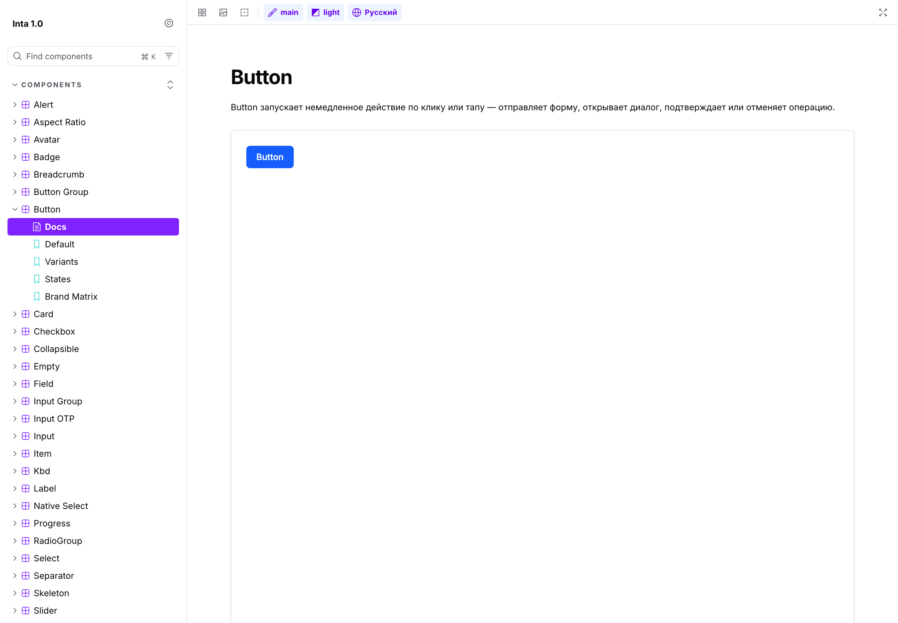
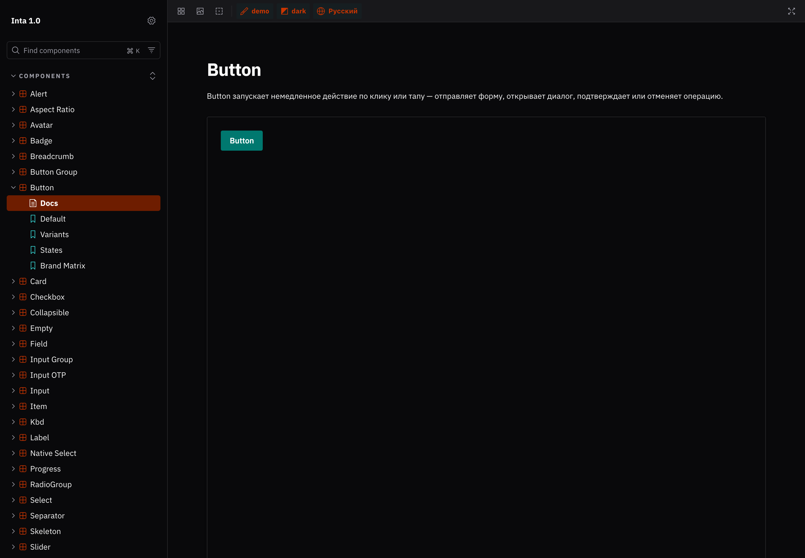

# Inta 1.0 — Design System

**Live Storybook:** https://main--6ad4a76c23be4704dc8eca20.chromatic.com

[English](#english) · [Русский](#русский)

<p>
  
  
</p>

---

## English

Multi-brand (white-label) design system with light/dark themes. Figma Variables are the single
source of truth; the pipeline generates CSS tokens consumed by a React + TypeScript + Tailwind CSS
v4 + shadcn/ui component library, documented in Storybook. 31 components, two brands (`main` /
`demo`) that swap color, radius and typeface — switching brands with no visual change left over
means a component is missing a token.

### Key decisions

- **Tokens are the source of truth**, exported from Figma Variables and compiled to CSS — never
  hand-edited.
- **Token linter** (`tokens:check`) fails the build on any hex/rgb, Tailwind palette class, or
  arbitrary value in component code.
- **Contrast checked automatically** — WCAG and APCA for every surface/content token pair, across
  all 4 brand × theme combinations (`tokens:contrast`).
- **Figma ↔ code parity verified numerically**, not by eye — computed styles and page layout are
  diffed against the Figma file (`figma:diff`, `figma:layout`).
- **Documentation in two languages** (this README and the component docs) so the system is usable
  by both Russian- and English-speaking teams.
- **Accessibility verified in code** — each component's Storybook docs state exactly what's
  automatic (via Radix/shadcn) versus the consumer's responsibility.
- **Visual regression testing in Chromatic** on every PR. Each component has a `BrandMatrix` story
  rendering all 4 brand × theme combinations side by side — Chromatic snapshots each story once,
  not the same story 4 times per combination.

### Run locally

```bash
npm ci
npm run storybook   # :6006, toolbar toggles Brand (main/demo) × Theme (light/dark)
```

### Key commands

| Command | What it does |
|---|---|
| `npm run tokens:build` | `tokens/tokens.json` → `src/styles/tokens.css` |
| `npm run tokens:check` | Lints components for non-token values — must be 0 errors |
| `npm run tailwind:check` | Verifies every Tailwind class used in `src/components` exists in the built CSS |
| `npm run tokens:contrast` | WCAG + APCA for every `X` / `on-X` pair, all states, 4 brand × theme combos |
| `npm run storybook` | Storybook on :6006 |
| `npm run visual` | Snapshots every story in 4 combinations → `visual.local/` |
| `npm run figma:diff` | Numeric Figma ↔ `getComputedStyle` diff, 4 combinations |
| `npm run figma:layout` | Diffs the Figma `Components` page layout against a saved snapshot |
| `npm run verify` | Runs `tokens:check` + `tokens:contrast` + `tailwind:check` + `figma:diff` + `figma:layout` |

Internal working notes (task handoffs, roadmap) live in [`docs/internal/`](docs/internal/) — not
needed to use or evaluate the system, kept for process transparency.

---

## Русский

Мультибрендовая (white-label) дизайн-система со светлой и тёмной темой. Источник правды — Figma
Variables, из которых генерируются CSS-токены для библиотеки компонентов на React + TypeScript +
Tailwind CSS v4 + shadcn/ui, документированной в Storybook. 31 компонент, два бренда (`main` /
`demo`), различающиеся цветом, радиусами и шрифтом — если при переключении бренда что-то не
перекрасилось, значит в компоненте не хватает токена.

### Ключевые решения

- **Токены — источник правды**: экспортируются из Figma Variables и собираются в CSS, руками не
  правятся.
- **Линтер токенов** (`tokens:check`) ловит в коде компонентов hex/rgb, палитру Tailwind
  (`bg-blue-500`) и произвольные значения (`p-[13px]`).
- **Проверка контраста** WCAG и APCA для всех пар поверхность/контент, во всех состояниях и всех
  4 комбинациях бренд × тема (`tokens:contrast`).
- **Сверка Figma ↔ код — цифровая, не на глаз**: вычисленные стили и раскладка страницы сравниваются
  с файлом Figma (`figma:diff`, `figma:layout`).
- **Документация на двух языках** (этот README и истории компонентов), чтобы система была понятна
  и русско-, и англоязычной команде.
- **Доступность проверена по коду** — в документации каждого компонента явно сказано, что работает
  автоматически (через Radix/shadcn), а что остаётся на совести того, кто использует компонент.
- **Визуальные тесты в Chromatic** на каждый PR. У каждого компонента есть история `BrandMatrix`,
  показывающая все 4 комбинации бренд × тема рядом — Chromatic снимает каждую историю один раз, а
  не одну и ту же историю в 4 комбинациях.

### Как запустить локально

```bash
npm ci
npm run storybook   # :6006, тулбар переключает Brand (main/demo) × Theme (light/dark)
```

### Основные команды

| Команда | Что делает |
|---|---|
| `npm run tokens:build` | `tokens/tokens.json` → `src/styles/tokens.css` |
| `npm run tokens:check` | Линтер компонентов на «не-токены» — должен давать 0 ошибок |
| `npm run tailwind:check` | Каждый Tailwind-класс из `src/components` реально есть в собранном CSS |
| `npm run tokens:contrast` | WCAG и APCA для пар `X` / `on-X` во всех состояниях × 4 комбинации |
| `npm run storybook` | Storybook на :6006 |
| `npm run visual` | Снимки историй в 4 комбинациях бренд × тема → `visual.local/` |
| `npm run figma:diff` | Цифровая сверка Figma ↔ `getComputedStyle` в 4 комбинациях |
| `npm run figma:layout` | Раскладка страницы Components по снимку `figma/layout.json` |
| `npm run verify` | `tokens:check` + `tokens:contrast` + `tailwind:check` + `figma:diff` + `figma:layout` |

Внутренние рабочие заметки (хендоффы задач, roadmap) — в [`docs/internal/`](docs/internal/): не
нужны, чтобы пользоваться системой или оценить её, оставлены для прозрачности процесса.

<!-- test: проверка skip Chromatic (PR тестовый, не мёржить) -->
